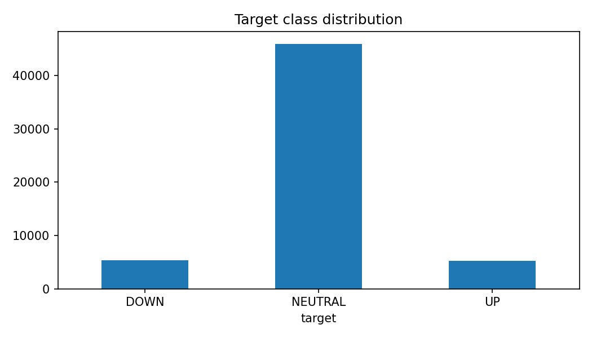
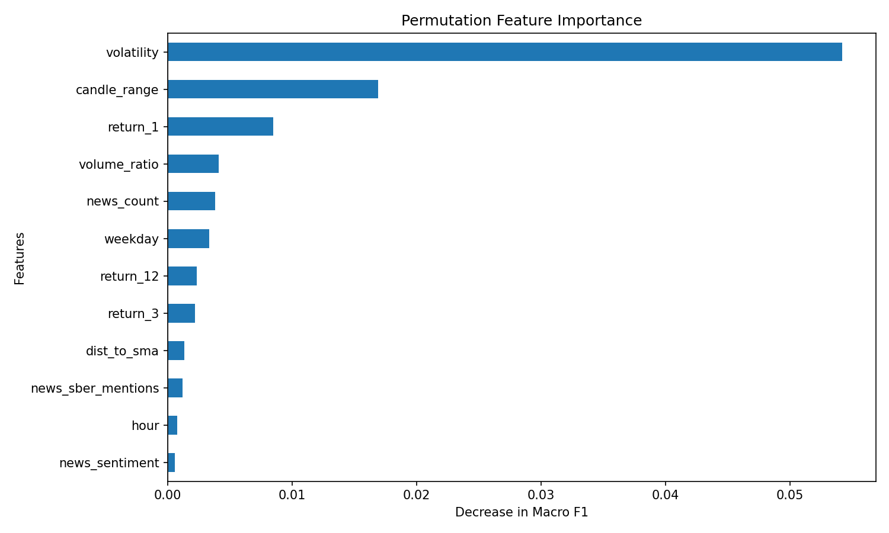
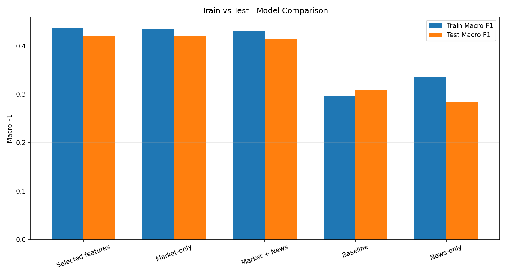
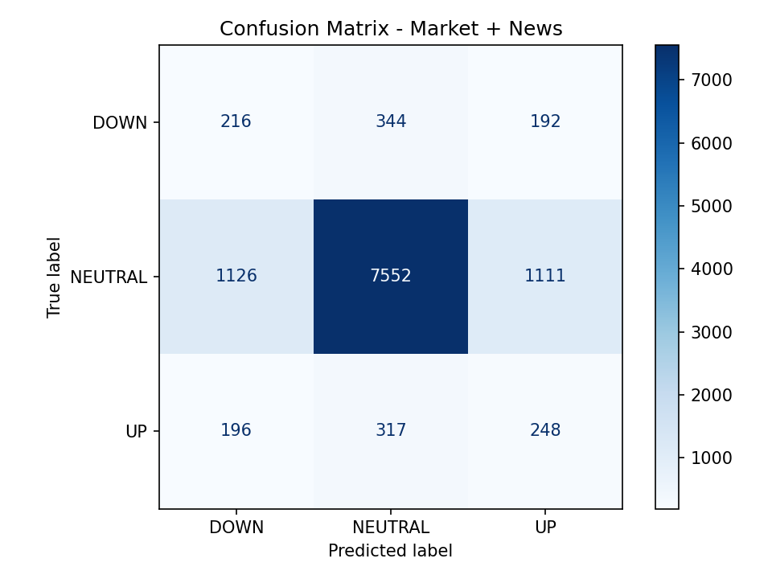

# News-based Predictor

Проект по машинному обучению, в котором мы исследуем, можно ли предсказывать краткосрочное направление изменения цены акций Сбербанка по биржевым данным и новостному фону. Работа связана с темой СНО НИЯУ МИФИ «Анализ влияния новостного фона на поведение финансовых рынков».

Главная идея состоит не в прогнозе точной цены акции, а в классификации следующего краткосрочного движения: падение, нейтральное изменение или рост. Отдельно сравниваются модели с рыночными признаками, только новостями и их сочетанием, чтобы проверить, дают ли новости дополнительную информацию.

## Данные

В проекте используются пятиминутные свечи Сбербанка и новости РИА за 2025 год. Данные хранятся в двух SQLite-базах, которые не включены в репозиторий:

- `data/market_data_clean.db`, таблица `sber_5min`: `datetime`, `open`, `high`, `low`, `close`, `volume`.
- `data/ria_news_all_2025.db`, таблица `news`: время публикации, заголовок и текст новости; в `comparator.py` используются также ID и теги.

Сырые базы и подготовленный `data/processed.csv` нужно разместить локально. В репозитории находятся скрипты и графики исследования, но не сами исходные данные.

## Исследование и подготовка данных: `analysis.py`

В этом файле выполняется загрузка SQLite-таблиц, очистка дат и числовых значений, расчет признаков и подготовка таблицы для обучения.

**Рыночные признаки:** доходность за одну, три и двенадцать свечей, отклонение от скользящей средней, волатильность, относительный объем, диапазон свечи, час и день недели.

**Новостные признаки:** число публикаций за предыдущие 60 минут, средняя условная тональность и количество новостей с упоминанием Сбербанка. Тональность считается простым способом по набору положительных и отрицательных ключевых слов. Это не нейросетевой анализ текста, поэтому используется понятный словарный подход, чтобы сначала проверить саму гипотезу.

Целевая переменная строится по изменению цены закрытия следующей свечи:

- `-1` (DOWN), если изменение меньше -0.1%;
- `0` (NEUTRAL), если изменение находится в диапазоне от -0.1% до +0.1%;
- `1` (UP), если изменение больше +0.1%.

В исследовании строятся графики цен, доходностей, объемов, количества и тональности новостей, распределения классов, корреляций и связи отдельных признаков с целевой переменной. Они сохранены в папке [`reports/`](reports/).

## Обучение модели: `model.py`

Основной классификатор в текущей версии `model.py` - **LogisticRegression** из Scikit-learn. Перед моделью используется `StandardScaler`, а `class_weight='balanced'` помогает учитывать неравномерное распределение классов.

Данные разделяются по времени на Train, Validation и Test, без случайного перемешивания: для финансового временного ряда важно, чтобы обучение не использовало будущие наблюдения относительно проверяемых.

Дополнительно рассчитывается важность признаков методом `permutation_importance`. Для оценки используется **Macro F1**, поскольку нейтральный класс встречается значительно чаще роста и падения. Также считаются Accuracy и разница качества на Train и Test.

Сравниваются четыре набора признаков:

1. **Market-only** - только рыночные данные.
2. **News-only** - только новостные признаки.
3. **Market + News** - объединение двух групп.
4. **Selected features** - признаки, отобранные по важности на Validation.

Для ориентира используется `DummyClassifier`, который всегда предсказывает самый частый класс. Графики сравнения моделей, важности признаков и матрица ошибок сохраняются в `reports/`.

В текущей реализации таблица моделей сортируется по Test Macro F1. Это удобно для исследовательского сравнения, но выбирать окончательную модель по Test некорректно: для строгой оценки ее следует выбирать по Validation, оставляя Test только для финальной проверки.

## Дополнительный эксперимент: `comparator.py`

В репозитории также сохранен отдельный эксперимент с **LightGBM**. Он сравнивает рыночные признаки, новостные признаки и их сочетание. В этой версии используются другие наборы признаков и `TimeSeriesSplit` для проверки на последовательных отрезках временного ряда.

Таким образом, `model.py` и `comparator.py` - два разных эксперимента. `model.py` не обучает LightGBM и не использует SBERT-эмбеддинги. Это важно учитывать при сравнении результатов.

## Графики

**Распределение трех классов**



**Важность признаков**



**Сравнение моделей на Train и Test**



**Матрица ошибок для Market + News**



## Запуск

После установки необходимых библиотек и размещения локальных баз в папке `data/`:

```bash
python analysis.py
python model.py
```

Первый скрипт формирует `data/processed.csv`, второй обучает и оценивает Logistic Regression. Для отдельного сравнения с LightGBM:

```bash
python comparator.py
```

Для запуска необходимы Python, NumPy, Pandas, Matplotlib, Scikit-learn и SQLite (через стандартный модуль Python). Для `comparator.py` дополнительно нужны LightGBM и tqdm. В репозитории есть `requirements.txt`, но он содержит и более тяжелые зависимости, не используемые текущим `model.py`.

## Ограничения

- Классы построены по очень небольшому изменению цены за короткий период, поэтому в данных много нейтральных наблюдений.
- Словарная тональность новостей не учитывает весь контекст текста и может ошибаться с иронией, отрицанием или неоднозначными формулировками.
- Временные метки свечей и новостей должны быть согласованы. Иначе возможно использование информации, которая еще не была доступна в момент прогноза.
- Хорошая классификационная метрика не равна прибыльной торговой стратегии. В проекте не проверяются комиссии, проскальзывание и реальные торговые ограничения.

Работа рассматривается как исследование влияния новостей на краткосрочные движения, а не как готовая система для торговли.
